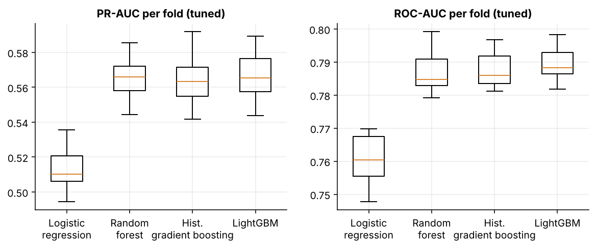
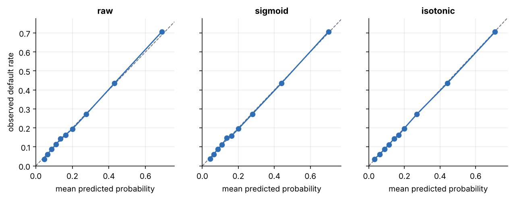
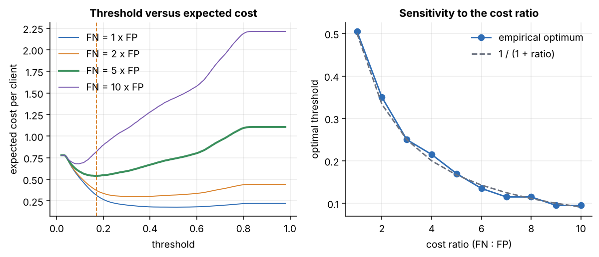
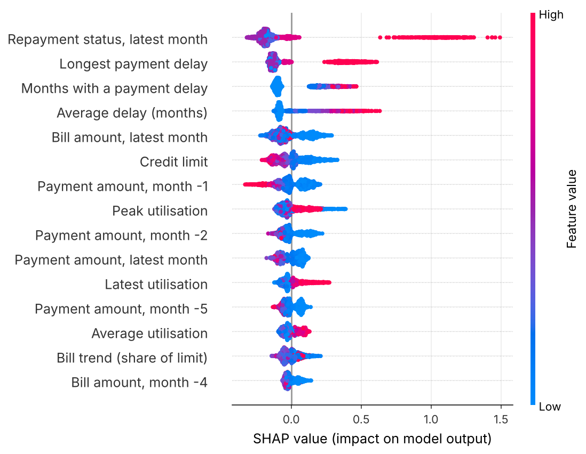
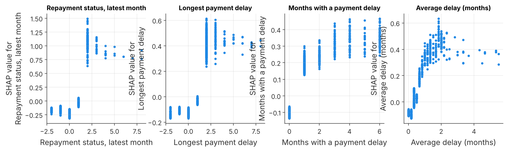
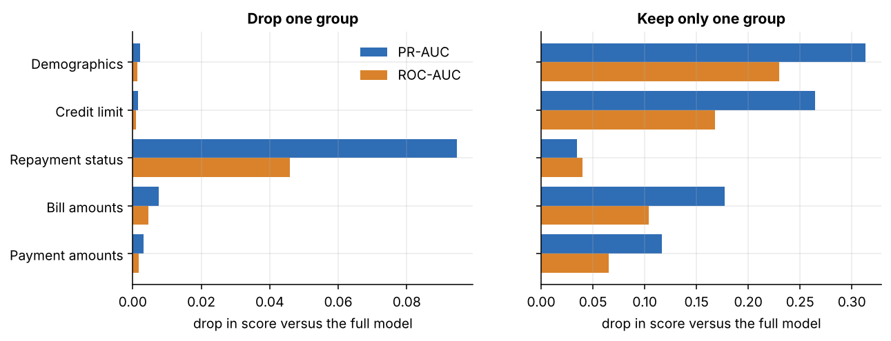
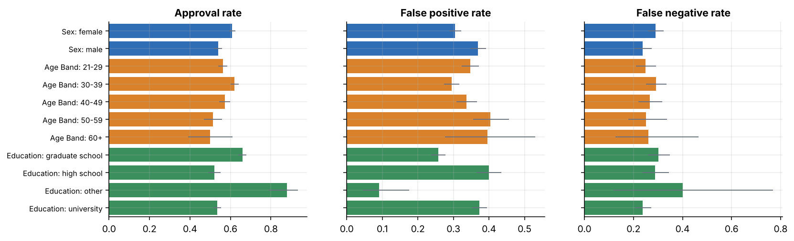
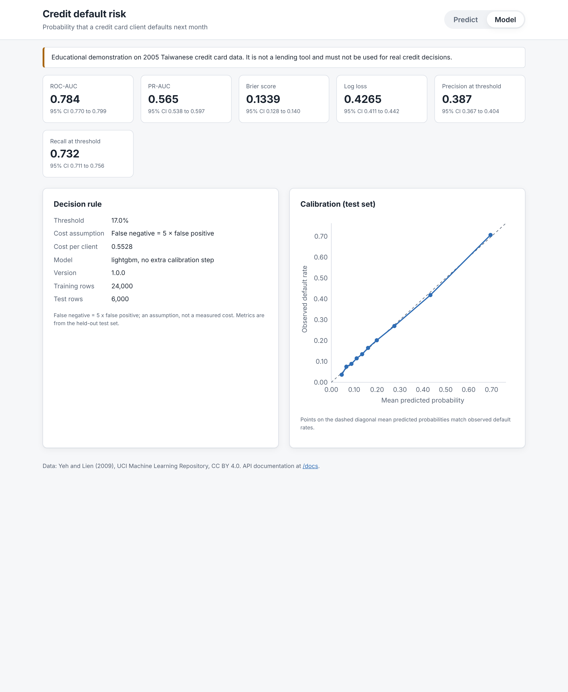

# Credit Default Risk

Calibrated credit card default prediction on the UCI "Default of Credit Card Clients" data, with a repeated-CV model comparison, a cost-based decision threshold, SHAP explanations, and a FastAPI service with a small web interface.

> Educational demonstration on 2005 Taiwanese data. Not for real lending decisions.

## Results summary

Hold-out test set (6,000 clients, evaluated once); intervals are 95% bootstrap intervals.

| Item | Value |
|---|---|
| Model | LightGBM (raw probabilities) |
| ROC-AUC | 0.784 (0.770 to 0.799) |
| PR-AUC | 0.565 (0.538 to 0.597) |
| Brier score | 0.1339 (0.1277 to 0.1396) |
| Log loss | 0.4265 (0.4108 to 0.4416) |
| Decision threshold | 0.170 |
| Precision / recall at threshold | 0.39 (0.37 to 0.40) / 0.73 (0.71 to 0.76) |
| Expected cost per client | 0.553 (flag nobody 1.106, flag everybody 0.779) |

## Key findings

- The selected LightGBM model reaches ROC-AUC 0.784 and PR-AUC 0.565 on the hold-out set; the cross-validated estimates (0.790 and 0.567) are consistent with it.
- Tree ensembles beat logistic regression by 0.053 PR-AUC in cross-validation, but the three tuned ensembles are not significantly different from each other, so the smaller one was chosen.
- Repayment status dominates: dropping that feature group lowers PR-AUC by 0.095, against at most 0.008 for any other group, and the top SHAP feature is repayment status, latest month.
- Raw gradient-boosting probabilities are already well calibrated (cross-validated ECE 0.012; isotonic 0.013), so no calibrator was kept; test-set ECE is 0.010.
- With a 5:1 cost ratio the threshold is 0.17, flagging 42% of test clients at 0.553 cost per client, versus 1.106 when flagging nobody.

## Quickstart

Requires Python 3.12 or newer. The raw data file is included in `data/raw/`.

```bash
make setup      # virtual environment and pinned dependencies
make train      # split, cross-validation, tuning, calibration, threshold, final fit
make evaluate   # one-time hold-out evaluation and model card
make run        # API and web interface on http://localhost:8000
```

Other targets: `make data` (Excel to clean CSV), `make eda`, `make report` (report and this README from `results/`), `make test`, `make lint`, `make all` (everything from scratch; stages are rerun with `FORCE=1`).

Docker:

```bash
docker build -t credit-risk:latest .
docker run --rm -p 8000:8000 credit-risk:latest
```

See `docs/deployment.md` for hosting and environment variables.

## Method

**Data.** 30,000 clients, 22.1% defaulted in the following month. Undocumented category codes (EDUCATION 0, 5, 6 and MARRIAGE 0) are merged into the documented "other" categories; the inconsistent column name `PAY_0` is renamed `PAY_1`. See `docs/data.md` for the data card, license and citation.

**Validation protocol.** A stratified 20% hold-out set (6,000 clients) is created once with a fixed seed; its ids are stored in `results/split.json`, and the loader used for training and EDA cannot return it. All tuning and selection use the 24,000 training clients. Models are compared with repeated stratified 5-fold cross-validation (3 repeats) on identical folds. Preprocessing (scaling, one-hot encoding, engineered features) sits inside the scikit-learn pipeline, so it is fitted on training folds only; tests check this.

**Features.** Raw columns plus engineered ones configured in `configs/config.yaml`: utilisation (bill / limit), payment-to-bill ratios, number and length of payment delays, a repayment-status trend and a bill trend.

**Models.** Majority-class dummy and logistic regression as baselines; random forest, histogram gradient boosting and LightGBM as candidates. Hyperparameters come from a random search (at most 15 candidates, 3-fold CV on folds different from the evaluation folds). Models are compared with the corrected resampled t-test and the Wilcoxon signed-rank test on fold-wise differences. When the top candidates are not significantly different, the smaller model is chosen.

**Calibration.** Sigmoid and isotonic calibration (cross-validated, refitted inside each outer fold) are compared with the raw model on Brier score, log loss, expected calibration error and a Brier decomposition. A calibrator replaces the raw model only if the log-loss gain is significant.

**Cost-based decision.** A client is flagged when the predicted probability reaches a threshold chosen to minimise expected cost on out-of-fold predictions. Default assumption: a missed default costs 5 times a declined good client. This is an assumption, not a measurement; the sensitivity analysis covers ratios 1 to 10.

**Interpretability.** Global and per-prediction SHAP values (tree explainer); one-hot columns are summed back to their feature. A feature-group ablation drops one group at a time and keeps one group at a time.

**Fairness diagnostic.** Approval rate, false positive rate and false negative rate by sex, age band and education, with Wilson intervals. It is descriptive and makes no claim of fairness.

## Results

### Model comparison (cross-validation on the training set)

| Model | ROC-AUC | PR-AUC | Brier | Log loss |
|---|---|---|---|---|
| Majority class (default) | 0.5000 ± 0.0000 | 0.2212 ± 0.0001 | 0.1723 ± 0.0000 | 0.5284 ± 0.0001 |
| Logistic regression (default) | 0.7605 ± 0.0069 | 0.5130 ± 0.0110 | 0.1399 ± 0.0014 | 0.4440 ± 0.0038 |
| Random forest (default) | 0.7829 ± 0.0054 | 0.5580 ± 0.0129 | 0.1343 ± 0.0018 | 0.4280 ± 0.0045 |
| Hist. gradient boosting (default) | 0.7818 ± 0.0049 | 0.5566 ± 0.0130 | 0.1346 ± 0.0019 | 0.4302 ± 0.0046 |
| LightGBM (default) | 0.7817 ± 0.0045 | 0.5588 ± 0.0109 | 0.1345 ± 0.0017 | 0.4300 ± 0.0041 |
| LightGBM (tuned) | 0.7898 ± 0.0050 | 0.5666 ± 0.0141 | 0.1327 ± 0.0018 | 0.4231 ± 0.0043 |
| Random forest (tuned) | 0.7871 ± 0.0056 | 0.5657 ± 0.0127 | 0.1331 ± 0.0020 | 0.4243 ± 0.0046 |
| Hist. gradient boosting (tuned) | 0.7878 ± 0.0054 | 0.5641 ± 0.0147 | 0.1330 ± 0.0018 | 0.4241 ± 0.0042 |
| Logistic regression (tuned) | 0.7612 ± 0.0071 | 0.5133 ± 0.0108 | 0.1399 ± 0.0014 | 0.4440 ± 0.0038 |

Tuned candidates are statistically indistinguishable on PR-AUC (corrected t-test p-values 0.52, 0.32, 0.53); logistic regression is clearly behind (PR-AUC difference 0.053).



### Hold-out test result

| Metric | Value (95% CI) |
|---|---|
| ROC-AUC | 0.784 (0.770 to 0.799) |
| PR-AUC | 0.565 (0.538 to 0.597) |
| Brier score | 0.1339 (0.1277 to 0.1396) |
| Log loss | 0.4265 (0.4108 to 0.4416) |
| Precision at threshold | 0.387 (0.367 to 0.404) |
| Recall at threshold | 0.732 (0.711 to 0.756) |
| Confusion (TP / FP / FN / TN) | 972 / 1542 / 355 / 3131 |

### Calibration

| Method | Brier | Log loss | ECE |
|---|---|---|---|
| raw | 0.13274 ± 0.00182 | 0.42312 ± 0.00429 | 0.0124 ± 0.0036 |
| sigmoid | 0.13274 ± 0.00184 | 0.42303 ± 0.00433 | 0.0131 ± 0.0039 |
| isotonic | 0.13280 ± 0.00191 | 0.42377 ± 0.00443 | 0.0129 ± 0.0050 |



### Cost curve

Chosen threshold 0.170 (cost ratio 5:1); the theoretical threshold for calibrated probabilities is 0.167.



| FN:FP | Optimal threshold | Flagged | Cost | Cost at the chosen threshold |
|---|---|---|---|---|
| 1 | 0.505 | 11.9% | 0.178 | 0.316 |
| 2 | 0.350 | 19.0% | 0.299 | 0.372 |
| 3 | 0.250 | 27.1% | 0.396 | 0.428 |
| 4 | 0.215 | 32.0% | 0.476 | 0.484 |
| 5 | 0.170 | 42.5% | 0.540 | 0.540 |
| 6 | 0.135 | 55.1% | 0.585 | 0.596 |
| 7 | 0.115 | 63.3% | 0.617 | 0.652 |
| 8 | 0.115 | 63.3% | 0.642 | 0.708 |
| 9 | 0.095 | 71.4% | 0.662 | 0.764 |
| 10 | 0.095 | 71.4% | 0.679 | 0.820 |

### SHAP





### Feature-group ablation

| Group | PR-AUC drop when removed | ROC-AUC drop when removed | PR-AUC alone |
|---|---|---|---|
| Demographics | 0.0021 | 0.0014 | 0.254 |
| Credit limit | 0.0015 | 0.0009 | 0.303 |
| Repayment status | 0.0946 | 0.0458 | 0.532 |
| Bill amounts | 0.0076 | 0.0045 | 0.390 |
| Payment amounts | 0.0032 | 0.0018 | 0.450 |



### Fairness diagnostic

Approval rates on the test set at threshold 0.17, across groups with at least 100 clients: sex 54% to 61%; age band 51% to 62%; education 52% to 66%. Descriptive diagnostic only. Group differences mix real differences in default rates with model behaviour, group sizes are uneven, and rates have wide intervals for small groups. Error-rate parity, calibration within groups and equal approval rates cannot all hold when base rates differ. SEX and EDUCATION are model inputs in this benchmark; using them (or close proxies) in real lending can be restricted by law. Nothing here establishes that the model is fair.



The complete report, with error analysis and all tables, is in `reports/report.md`; the exploratory analysis is in `reports/eda_summary.md`.

## API reference

Interactive documentation: `/docs`. Errors share one format: `{"error": {"code", "message", "details": [{"field", "message"}]}}`.

| Method and path | Purpose |
|---|---|
| `GET /health` | Liveness and whether the model is loaded |
| `GET /model-info` | Metrics, threshold, cost assumption, calibration curve, feature schema |
| `POST /predict` | Default probability, decision, risk band; `?explain=true&top_k=5` adds top factors |
| `POST /predict/batch` | Up to 100 applicants per request; same query parameters |

Field names are the dataset columns in lower case: `limit_bal`, `sex` (1, 2), `education` (1 to 4), `marriage` (1 to 3), `age` (18 to 100), `pay_1` to `pay_6` (-2 to 9), `bill_amt1` to `bill_amt6`, `pay_amt1` to `pay_amt6` (0 or more). Month 1 is the most recent (September 2005). Unknown fields are rejected.

```bash
curl -s -X POST 'http://localhost:8000/predict?explain=true&top_k=3' \
  -H 'Content-Type: application/json' \
  -d '{"limit_bal":30000,"sex":1,"education":3,"marriage":2,"age":27,"pay_1":2,"pay_2":2,"pay_3":2,"pay_4":1,"pay_5":0,"pay_6":0,"bill_amt1":29500,"bill_amt2":28900,"bill_amt3":28000,"bill_amt4":27000,"bill_amt5":25500,"bill_amt6":24000,"pay_amt1":0,"pay_amt2":1500,"pay_amt3":0,"pay_amt4":1200,"pay_amt5":1000,"pay_amt6":1000}'
```

Response (values produced by the trained model):

```json
{
  "default_probability": 0.6124,
  "flagged": true,
  "decision": "flag as likely default",
  "threshold": 0.17,
  "risk_band": "high",
  "explanation": [
    {
      "feature": "PAY_1",
      "label": "Repayment status, latest month",
      "value": 2,
      "contribution": 0.898,
      "direction": "increases risk"
    },
    {
      "feature": "max_delay",
      "label": "Longest payment delay",
      "value": 2,
      "contribution": 0.42,
      "direction": "increases risk"
    },
    {
      "feature": "mean_delay",
      "label": "Average delay (months)",
      "value": 1.167,
      "contribution": 0.266,
      "direction": "increases risk"
    }
  ],
  "model_version": "1.0.0",
  "explanation_unit": "log-odds"
}
```

Contributions are in the model's margin units (log-odds); positive values raise the predicted risk.

## Web interface

The interface is served at `/`: a form with example presets, a probability gauge, decision and risk band, a factor chart, and a Model tab with the test metrics, threshold, cost assumption and calibration curve. It follows the system light or dark setting.




## Limitations

- The data are from one Taiwanese bank in 2005 and describe a specific credit-card cycle; they do not represent current customers or other markets.
- The 5:1 cost ratio is an assumption. Real costs depend on interest margins, collection costs and policy, and the sensitivity table shows how the threshold moves.
- There is no real-world validation: results are from a random hold-out split of the same period, with no temporal or external test.
- The fairness diagnostic is descriptive. Sex and education are model inputs here (as in the original benchmark); using them, or proxies, can be restricted in real lending. Some groups are small and their intervals wide.
- Cross-validated tuning on the training set is slightly optimistic for the selected model; the hold-out result is the unbiased estimate.
- SHAP values describe the model, not causal effects.

## Repository structure

```
configs/config.yaml        all settings (paths, features, CV, models, cost matrix)
data/raw/                  original Excel file (tracked); data/interim/ is generated
src/credit_risk/           data, features, models, cv, tuning, calibration, cost, explain, fairness, ...
src/credit_risk/api/       FastAPI service and static web interface
scripts/                   data card, report and README generators, download fallback
results/                   JSON and CSV outputs of every stage (source of all reported numbers)
artifacts/                 model.joblib and model_card.json
reports/                   EDA and evaluation report with figures
docs/                      data card, decisions log, deployment guide, screenshots
tests/                     unit and API tests (synthetic data only)
```

## Reproducibility

- Fixed seed (42) in `configs/config.yaml`; fold seeds are derived from it. Dependencies are pinned in `requirements*.txt` and `pyproject.toml`.
- Every figure in this file and in `reports/report.md` is generated from `results/` or `artifacts/` by `scripts/make_report.py` and `scripts/make_readme.py`.
- The raw file SHA-256 is `30c6be3abd8dcfd3e6096c828bad8c2f011238620f5369220bd60cfc82700933` and is stored in `results/data_summary.json` and the model card.
- `artifacts/model_card.json` records metrics, threshold, cost assumption, feature schema, library versions and the git commit of the code that produced the model.
- Training uses the CPU only. A full `make all` takes roughly half an hour on four cores; stages that already have outputs are skipped by `make train`.

## License and citations

Code: MIT License (`LICENSE`). Data: CC BY 4.0 (UCI Machine Learning Repository).

Yeh, I. C., and Lien, C. H. (2009). The comparisons of data mining techniques for the predictive accuracy of probability of default of credit card clients. Expert Systems with Applications, 36(2), 2473-2480.

Dataset: Yeh, I. C. (2016). Default of Credit Card Clients. UCI Machine Learning Repository.
