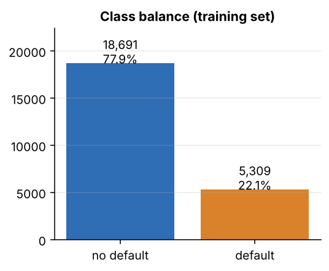
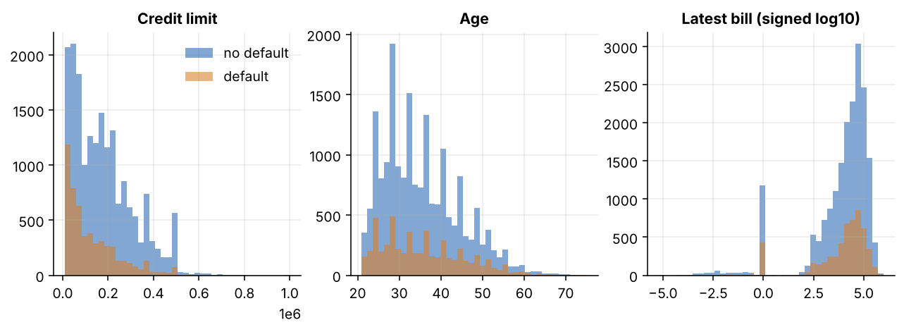
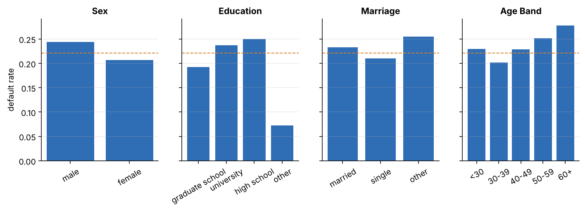
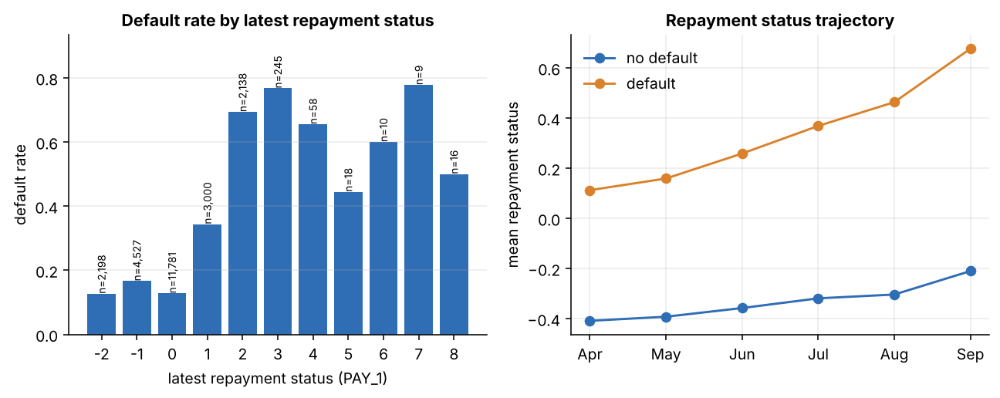
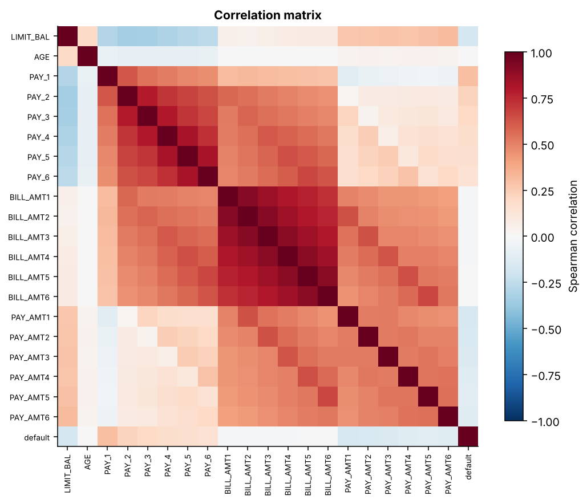

# Exploratory data analysis (training set)

Generated by `credit_risk.eda` from the training split only.

- Rows: 24,000; default rate 22.12%; missing values: 0.
- Median credit limit: 140,000; age range 21 to 75.
- Default rate for clients paying duly (PAY_1 = -1): 16.6%; for a two-month delay (PAY_1 = 2): 69.4%.
- Mean pairwise correlation between the six repayment-status columns: 0.65.

## Odd values

- Clients with at least one negative bill amount: 6.47%.
- Clients with a bill above the credit limit in any month: 13.04%.
- Share of zero payments across all client-months: 20.6%.
- Undocumented repayment codes: -2 in 13.6% and 0 in 53.3% of client-months.

## Correlation with the target (Pearson)

| Feature | Correlation |
|---|---|
| PAY_1 | +0.328 |
| PAY_2 | +0.266 |
| PAY_3 | +0.239 |
| PAY_4 | +0.220 |
| PAY_5 | +0.203 |
| PAY_6 | +0.189 |
| LIMIT_BAL | -0.161 |
| PAY_AMT1 | -0.073 |

## Figures

