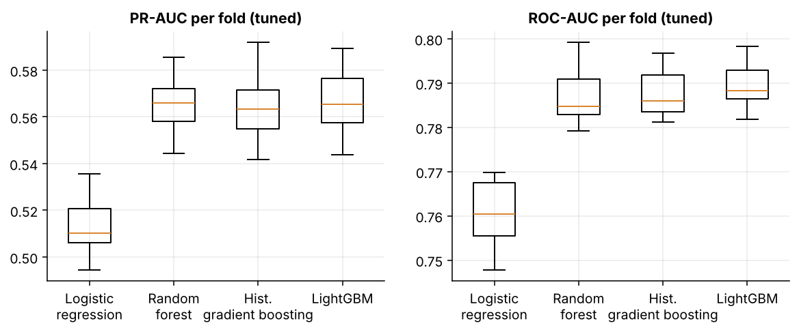
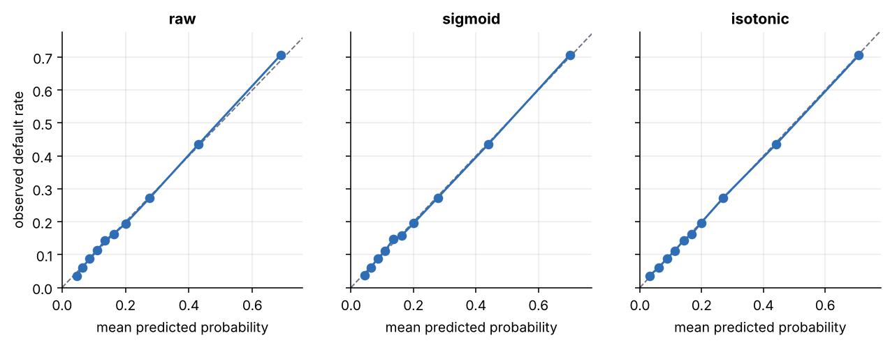
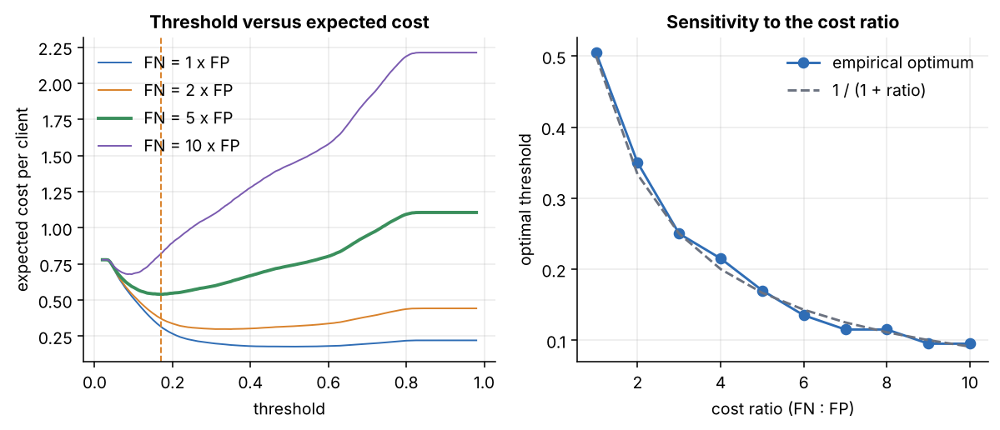
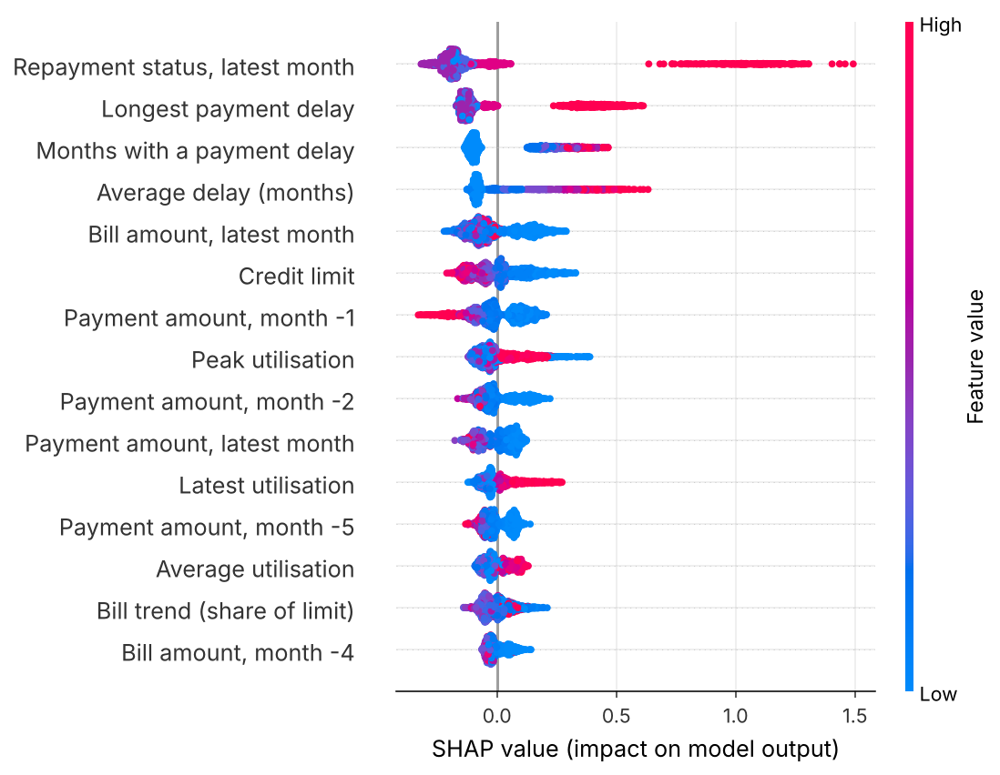
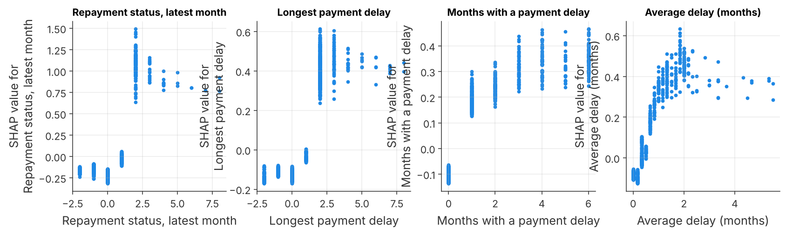
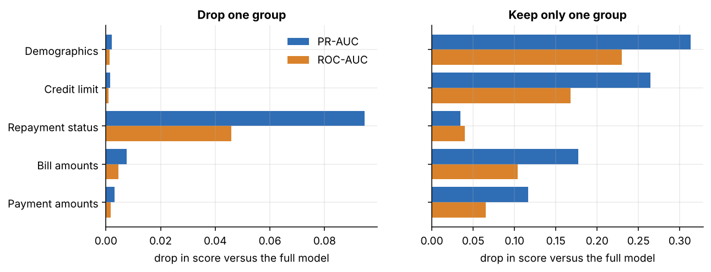
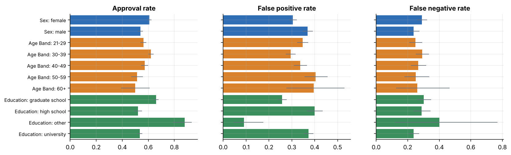
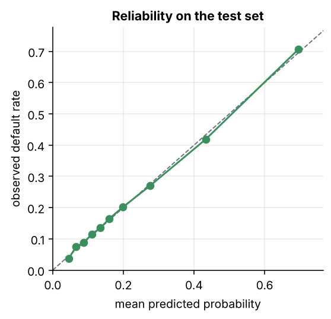

# Credit default risk: evaluation report

Generated by `scripts/make_report.py` from the files in `results/`.

## Data and split

| Item | Value |
|---|---|
| Clients | 30,000 |
| Default rate | 22.12% |
| Training rows | 24,000 (default rate 22.12%) |
| Hold-out test rows | 6,000 (default rate 22.12%) |
| Raw file SHA-256 | `30c6be3abd8dcfd3...` |

## Model comparison

Repeated stratified 5-fold cross-validation with 3 repeats on the training set; mean ± standard deviation over folds. All models share the same folds.

### Default parameters

| Model | ROC-AUC | PR-AUC | Brier | Log loss |
|---|---|---|---|---|
| Majority class | 0.5000 ± 0.0000 | 0.2212 ± 0.0001 | 0.1723 ± 0.0000 | 0.5284 ± 0.0001 |
| Logistic regression | 0.7605 ± 0.0069 | 0.5130 ± 0.0110 | 0.1399 ± 0.0014 | 0.4440 ± 0.0038 |
| Random forest | 0.7829 ± 0.0054 | 0.5580 ± 0.0129 | 0.1343 ± 0.0018 | 0.4280 ± 0.0045 |
| Hist. gradient boosting | 0.7818 ± 0.0049 | 0.5566 ± 0.0130 | 0.1346 ± 0.0019 | 0.4302 ± 0.0046 |
| LightGBM | 0.7817 ± 0.0045 | 0.5588 ± 0.0109 | 0.1345 ± 0.0017 | 0.4300 ± 0.0041 |

### Tuned parameters

Random search, 15 candidates per model at most, 3-fold CV scored by `average_precision`, on folds that differ from the evaluation folds.

| Model | ROC-AUC | PR-AUC | Brier | Log loss |
|---|---|---|---|---|
| Logistic regression | 0.7612 ± 0.0071 | 0.5133 ± 0.0108 | 0.1399 ± 0.0014 | 0.4440 ± 0.0038 |
| Random forest | 0.7871 ± 0.0056 | 0.5657 ± 0.0127 | 0.1331 ± 0.0020 | 0.4243 ± 0.0046 |
| Hist. gradient boosting | 0.7878 ± 0.0054 | 0.5641 ± 0.0147 | 0.1330 ± 0.0018 | 0.4241 ± 0.0042 |
| LightGBM | 0.7898 ± 0.0050 | 0.5666 ± 0.0141 | 0.1327 ± 0.0018 | 0.4231 ± 0.0043 |

### Best hyperparameters

| Model | Search PR-AUC | Parameters |
|---|---|---|
| Logistic regression | 0.5138 | `C=0.03` |
| Random forest | 0.5628 | `n_estimators=500, min_samples_leaf=10, max_features=0.5, max_depth=8` |
| Hist. gradient boosting | 0.5626 | `min_samples_leaf=100, max_leaf_nodes=8, max_iter=150, learning_rate=0.05, l2_regularization=1.0` |
| LightGBM | 0.5645 | `subsample=0.7, reg_lambda=10.0, num_leaves=31, n_estimators=400, min_child_samples=50, learning_rate=0.01, colsample_bytree=0.7` |

### Paired fold-wise comparison

Differences are computed fold by fold (same splits). The corrected resampled t-test (Nadeau and Bengio) accounts for overlapping training sets; the Wilcoxon signed-rank test does not and is shown for reference.

| Pair (A vs B) | Metric | Mean diff (A-B) | Corrected t-test p | Wilcoxon p |
|---|---|---|---|---|
| LightGBM vs Random forest | pr_auc | +0.0009 | 0.516 | 0.3028 |
| LightGBM vs Random forest | roc_auc | +0.0027 | 0.004 | 0.0002 |
| LightGBM vs Hist. gradient boosting | pr_auc | +0.0025 | 0.321 | 0.0353 |
| LightGBM vs Hist. gradient boosting | roc_auc | +0.0020 | 0.077 | 0.0012 |
| Random forest vs Hist. gradient boosting | pr_auc | +0.0016 | 0.528 | 0.1876 |
| Random forest vs Hist. gradient boosting | roc_auc | -0.0006 | 0.656 | 0.3303 |
| LightGBM vs Logistic regression | pr_auc | +0.0533 | 0.000 | 0.0001 |
| LightGBM vs Logistic regression | roc_auc | +0.0286 | 0.000 | 0.0001 |

Selected model: **LightGBM**. Rule: highest mean pr_auc; models whose paired difference to the top is not significant (corrected resampled t-test, alpha=0.05) are treated as ties and the first in tie_break_order is chosen.

## Probability calibration

Calibration is cross-validated (5 inner folds) and wrapped around the full pipeline, so it is re-fitted inside every outer fold. Equal-frequency reliability bins on pooled out-of-fold predictions; Brier decomposition uses 10 equal-width bins.

| Method | Brier | Log loss | ECE | Reliability | Resolution | Uncertainty |
|---|---|---|---|---|---|---|
| raw | 0.13274 ± 0.00182 | 0.42312 ± 0.00429 | 0.01236 ± 0.00360 | 0.00007 | 0.03893 | 0.17228 |
| sigmoid | 0.13274 ± 0.00184 | 0.42303 ± 0.00433 | 0.01315 ± 0.00391 | 0.00004 | 0.03888 | 0.17228 |
| isotonic | 0.13280 ± 0.00191 | 0.42377 ± 0.00443 | 0.01288 ± 0.00497 | 0.00006 | 0.03882 | 0.17228 |

Paired log-loss difference, raw minus calibrated (positive favours calibration):

| Method | Mean diff | Corrected t-test p |
|---|---|---|
| sigmoid | +0.00009 | 0.662 |
| isotonic | -0.00065 | 0.358 |

Selected: **raw**. Rule: lowest mean log loss; a calibration method replaces the raw model only if the improvement is significant (corrected resampled t-test, alpha=0.05).

## Cost-based decision rule

Assumption: False negative = 5 x false positive; an assumption, not a measured cost. Cost of a correct decision is zero. The threshold minimises the expected cost on out-of-fold training predictions (averaged over repeats).

| Item | Value |
|---|---|
| Chosen threshold | 0.170 |
| Bayes threshold for calibrated probabilities (cost_fp / (cost_fp + cost_fn)) | 0.167 |
| Expected cost per client (out-of-fold) | 0.5399 |
| Cost if nobody is flagged / everybody is flagged | 1.1060 / 0.7788 |
| Share of clients flagged | 42.5% |
| Precision at threshold (out-of-fold) | 0.3889 ± 0.0053 |
| Recall at threshold (out-of-fold) | 0.7466 ± 0.0104 |

### Sensitivity to the cost ratio

| FN:FP | Optimal threshold | Bayes threshold | Flagged | Cost | Cost at 5:1 threshold | Flag nobody | Flag everybody |
|---|---|---|---|---|---|---|---|
| 1 | 0.505 | 0.500 | 11.9% | 0.1780 | 0.3157 | 0.2212 | 0.7788 |
| 2 | 0.350 | 0.333 | 19.0% | 0.2990 | 0.3717 | 0.4424 | 0.7788 |
| 3 | 0.250 | 0.250 | 27.1% | 0.3957 | 0.4278 | 0.6636 | 0.7788 |
| 4 | 0.215 | 0.200 | 32.0% | 0.4759 | 0.4838 | 0.8848 | 0.7788 |
| 5 | 0.170 | 0.167 | 42.5% | 0.5399 | 0.5399 | 1.1060 | 0.7788 |
| 6 | 0.135 | 0.143 | 55.1% | 0.5845 | 0.5959 | 1.3273 | 0.7788 |
| 7 | 0.115 | 0.125 | 63.3% | 0.6168 | 0.6520 | 1.5485 | 0.7788 |
| 8 | 0.115 | 0.111 | 63.3% | 0.6424 | 0.7081 | 1.7697 | 0.7788 |
| 9 | 0.095 | 0.100 | 71.4% | 0.6618 | 0.7641 | 1.9909 | 0.7788 |
| 10 | 0.095 | 0.091 | 71.4% | 0.6786 | 0.8202 | 2.2121 | 0.7788 |

## Interpretability

SHAP values for the fitted model on 2,000 random training rows. Units: model margin (log-odds) for gradient-boosted trees. One-hot columns are summed back to their original feature.

| Rank | Feature | Mean abs SHAP |
|---|---|---|
| 1 | Repayment status, latest month | 0.2650 |
| 2 | Longest payment delay | 0.2028 |
| 3 | Months with a payment delay | 0.1521 |
| 4 | Average delay (months) | 0.1246 |
| 5 | Bill amount, latest month | 0.0951 |
| 6 | Credit limit | 0.0858 |
| 7 | Payment amount, month -1 | 0.0847 |
| 8 | Peak utilisation | 0.0670 |
| 9 | Payment amount, month -2 | 0.0620 |
| 10 | Payment amount, latest month | 0.0607 |

## Feature-group ablation

Model: LightGBM (uncalibrated), repeated CV with 2 repeats on the same folds as the full model. Full model: PR-AUC 0.5668 ± 0.0167, ROC-AUC 0.7899 ± 0.0053. Engineered features belong to the group of the information they summarise.

| Group | Drop in PR-AUC (dropped) | Drop in ROC-AUC (dropped) | PR-AUC (only this group) | ROC-AUC (only this group) |
|---|---|---|---|---|
| Demographics | 0.0021 ± 0.0025 | 0.0014 ± 0.0010 | 0.2537 | 0.5600 |
| Credit limit | 0.0015 ± 0.0011 | 0.0009 ± 0.0009 | 0.3025 | 0.6219 |
| Repayment status | 0.0946 ± 0.0139 | 0.0458 ± 0.0049 | 0.5321 | 0.7502 |
| Bill amounts | 0.0076 ± 0.0047 | 0.0045 ± 0.0027 | 0.3896 | 0.6859 |
| Payment amounts | 0.0032 ± 0.0029 | 0.0018 ± 0.0013 | 0.4503 | 0.7250 |

## Fairness diagnostic

> Descriptive diagnostic only. Group differences mix real differences in default rates with model behaviour, group sizes are uneven, and rates have wide intervals for small groups. Error-rate parity, calibration within groups and equal approval rates cannot all hold when base rates differ. SEX and EDUCATION are model inputs in this benchmark; using them (or close proxies) in real lending can be restricted by law. Nothing here establishes that the model is fair.

Hold-out test set at threshold 0.170. Approval means not flagged. Intervals are 95% Wilson intervals.

| Attribute | Group | n | Default rate | Approval rate | FPR | FNR |
|---|---|---|---|---|---|---|
| Sex | female | 3598 | 21.3% | 60.9% | 30.5% | 29.0% |
| Sex | male | 2402 | 23.4% | 53.9% | 36.9% | 23.7% |
| Age Band | 21-29 | 1912 | 22.3% | 56.3% | 34.7% | 24.8% |
| Age Band | 30-39 | 2198 | 20.6% | 62.0% | 29.5% | 29.1% |
| Age Band | 40-49 | 1341 | 23.3% | 57.1% | 33.6% | 26.6% |
| Age Band | 50-59 | 473 | 23.7% | 51.4% | 40.4% | 25.0% |
| Age Band | 60+ | 76 | 30.3% | 50.0% | 39.6% | 26.1% |
| Education | graduate school | 2130 | 19.0% | 65.9% | 25.7% | 30.1% |
| Education | high school | 1014 | 25.7% | 52.0% | 40.0% | 28.7% |
| Education | other | 82 | 6.1% | 87.8% | 9.1% | 40.0% |
| Education | university | 2774 | 23.6% | 53.5% | 37.3% | 23.8% |

## Error analysis (hold-out test set)

- Defaults not flagged: 26.8% of all defaults; 9.2% of defaults received a probability below 0.10.
- Non-defaults with probability at or above 0.7: 1.16%.
- Mean PAY_1 among missed defaults -0.48 versus 1.04 among caught defaults.

| Segment | Level | n | Default rate | Mean predicted | Flagged | FNR | FPR | Cost per client |
|---|---|---|---|---|---|---|---|---|
| latest repayment status | 1 month late | 688 | 32.1% | 34.6% | 89.0% | 3.6% | 85.4% | 0.638 |
| latest repayment status | 2+ months late | 636 | 69.0% | 68.3% | 100.0% | 0.0% | 100.0% | 0.310 |
| latest repayment status | paid duly or no use | 1720 | 16.7% | 15.2% | 29.2% | 46.3% | 24.4% | 0.590 |
| latest repayment status | revolving | 2956 | 12.9% | 13.2% | 25.8% | 56.3% | 23.2% | 0.564 |
| months with a delay | 1-2 | 1221 | 30.6% | 33.0% | 86.1% | 6.4% | 82.8% | 0.672 |
| months with a delay | 3-6 | 744 | 60.3% | 59.7% | 99.9% | 0.0% | 99.7% | 0.395 |
| months with a delay | none | 4035 | 12.5% | 11.9% | 17.8% | 65.7% | 15.5% | 0.546 |
| credit limit | Q1 (lowest) | 1530 | 30.3% | 32.3% | 69.5% | 11.9% | 61.5% | 0.608 |
| credit limit | Q2 | 1547 | 24.1% | 23.8% | 44.1% | 26.5% | 34.8% | 0.584 |
| credit limit | Q3 | 1465 | 16.6% | 17.2% | 31.1% | 39.5% | 25.3% | 0.539 |
| credit limit | Q4 (highest) | 1458 | 17.0% | 14.5% | 21.3% | 42.3% | 13.9% | 0.475 |
| age | 21-29 | 1912 | 22.3% | 23.1% | 43.7% | 24.8% | 34.7% | 0.547 |
| age | 30-39 | 2198 | 20.6% | 20.4% | 38.0% | 29.1% | 29.5% | 0.534 |
| age | 40-49 | 1341 | 23.3% | 22.4% | 42.9% | 26.6% | 33.6% | 0.567 |
| age | 50-59 | 473 | 23.7% | 24.4% | 48.6% | 25.0% | 40.4% | 0.605 |
| age | 60+ | 76 | 30.3% | 24.9% | 50.0% | 26.1% | 39.6% | 0.671 |

### Most confident missed defaults (lowest probability)

| id | probability | default | PAY_1 | PAY_2 | n_delayed | LIMIT_BAL | AGE | util_mean | payratio_mean |
|---|---|---|---|---|---|---|---|---|---|
| 983 | 0.037 | 1 | -2 | -2 | 0 | 500000 | 36 | 0.074 | 1.0 |
| 28994 | 0.037 | 1 | 0 | 0 | 0 | 480000 | 39 | 0.29 | 0.416 |
| 16277 | 0.038 | 1 | 0 | 0 | 0 | 300000 | 31 | 0.087 | 0.608 |
| 8959 | 0.041 | 1 | 0 | 0 | 0 | 340000 | 44 | 0.279 | 0.218 |
| 3981 | 0.043 | 1 | 0 | 0 | 0 | 180000 | 26 | 0.31 | 0.056 |
| 10671 | 0.043 | 1 | 0 | 0 | 0 | 410000 | 48 | 0.041 | 0.606 |
| 971 | 0.044 | 1 | -1 | 0 | 0 | 300000 | 42 | 0.093 | 0.436 |
| 22712 | 0.044 | 1 | 0 | 0 | 0 | 320000 | 35 | 0.437 | 0.041 |

### Most confident false alarms (highest probability, no default)

| id | probability | default | PAY_1 | PAY_2 | n_delayed | LIMIT_BAL | AGE | util_mean | payratio_mean |
|---|---|---|---|---|---|---|---|---|---|
| 28748 | 0.801 | 0 | 3 | 2 | 6 | 50000 | 28 | 0.048 | 0.0 |
| 9672 | 0.798 | 0 | 2 | 2 | 6 | 170000 | 48 | 0.014 | 0.0 |
| 26713 | 0.795 | 0 | 2 | 2 | 6 | 30000 | 26 | 0.517 | 0.088 |
| 1522 | 0.79 | 0 | 3 | 3 | 6 | 60000 | 40 | 0.171 | 0.037 |
| 355 | 0.786 | 0 | 2 | 2 | 4 | 50000 | 58 | 0.364 | 0.064 |
| 22567 | 0.785 | 0 | 2 | 2 | 6 | 120000 | 30 | 0.604 | 0.042 |
| 10143 | 0.785 | 0 | 2 | 2 | 6 | 400000 | 39 | 0.131 | 0.04 |
| 16749 | 0.784 | 0 | 2 | 3 | 6 | 150000 | 36 | 0.597 | 0.038 |

## Final evaluation on the hold-out test set

Model: LightGBM, calibration: raw, threshold 0.170. Evaluated once on 6,000 clients; intervals are 95% percentile bootstrap (1000 resamples).

| Metric | Value (95% CI) |
|---|---|
| ROC-AUC | 0.7837 (0.7700 to 0.7990) |
| PR-AUC | 0.5653 (0.5382 to 0.5965) |
| Brier score | 0.13390 (0.12773 to 0.13962) |
| Log loss | 0.42653 (0.41081 to 0.44157) |
| Expected calibration error | 0.01026 |
| Precision at threshold | 0.3866 (0.3673 to 0.4042) |
| Recall at threshold | 0.7325 (0.7111 to 0.7556) |
| Expected cost per client | 0.5528 (0.5222 to 0.5820) |
| Cost if nobody is flagged / everybody is flagged | 1.1058 / 0.7788 |
| Share flagged | 41.9% |

|  | Predicted default | Predicted no default |
|---|---|---|
| Actual default | 972 | 355 |
| Actual no default | 1542 | 3131 |

Brier decomposition: reliability 0.00028, resolution 0.03806, uncertainty 0.17225.

